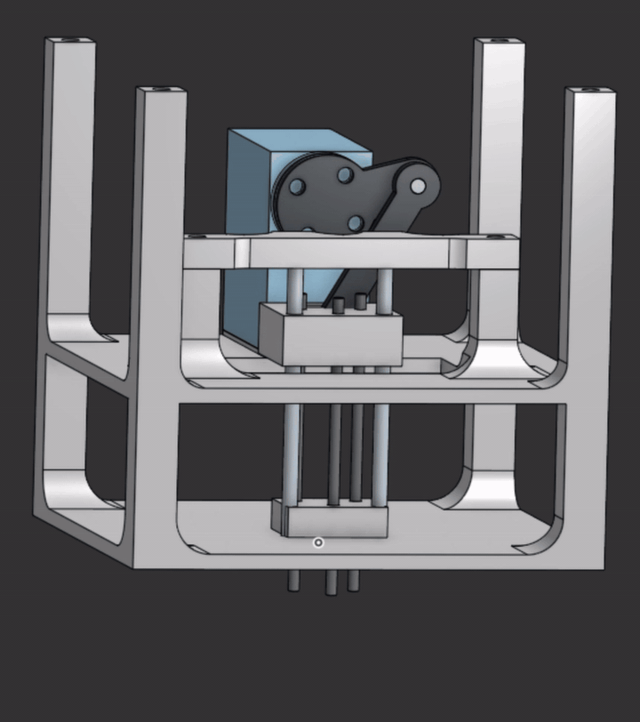
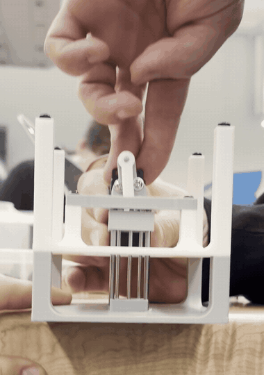

# IREC 2027 Payload: Pitot Probe Deployment Mechanism

Kent State Rocket Team, Payload Subsection, 2026 to present

This is the mechanism that pushes the pitot probes out of our team's weather station payload. We're
flying it at IREC in summer 2027. Right now it's in design: I've printed PLA+ prototypes of both
mechanism designs and run them on the servo, and I'm working on the linkage FEA. Nothing has been built
in flight hardware yet and nothing has flown.

*Current revision in CAD. One servo pushes straight pitot probes out of the bottom of the payload.*

[How the mechanism got here (design history)](payload/docs/design-history.md)

## The project

Our 2027 payload is a weather station in a 4U CubeSat form factor that rides in the team's L3 rocket.
My subsection is responsible for the mechanism that deploys the pitot probes.

The probes measure descent speed. After the payload is released it hangs straight down under its
tether, so a probe pointing down reads the airflow as it falls. Put that together with pressure altitude
and the weather station gets data on an altitude basis. Wind speed and direction are roughly estimated
from GPS.

## Current design

One servo turns a crank. A link turns that into straight-line travel of a carriage riding on two steel
guide rods, held in the base and by a bridge across the top. The carriage pushes straight stainless
probes down through a guide in the base plate, so they come out of the bottom already pointing into the
airflow. The model has three probes right now and we haven't locked in the final count.

Before this, the mechanism pushed four probes out of the side walls and every tube had to be bent to
face down. That got messy fast. The [design history](payload/docs/design-history.md) shows the old design
and why I moved away from it.

I printed this revision in PLA+ and ran it on the servo. I haven't designed the servo mount yet, so
I'm holding the servo by hand in the video. It hasn't gone through team review yet.

CAD exports are in [`payload/mechanism/cad/bottom-deploy`](payload/mechanism/cad/bottom-deploy).

## My role

I've been the Payload Subsection Lead since August 2026. I lead a 6-person subsection through design,
fabrication and integration, working from the senior payload lead's direction. I designed the
deployment mechanism and I'm running the analysis to pick materials for the linkage.

## What I'm working on now

- Linkage FEA and material choice. The first run is done and lines up with my hand calcs, but there's
  no final material yet.
- Hand calcs for normal deployment and for a jam at servo stall, so I have something to check the FEA
  against.
- The servo mount. Right now the servo is just a placeholder block in the model.
- A lock to hold the probes stowed during boost.

## Status

| Item | Status |
| --- | --- |
| CAD (Onshape) | In design |
| Bottom-deploy revision | Modeled, PLA+ prototype printed and run on the servo |
| Linkage FEA | First run done, no final results |
| Material | Not picked yet |
| Prototypes | Both designs printed in PLA+ |
| Servo mount | Not designed yet |
| Flight hardware | Not started |
| Load testing | Not started |
| Flight | IREC, summer 2027 |
| Flight data | None yet, it hasn't flown |

## Tools

Onshape for CAD and FEA, MATLAB for hand calcs and data, and a Bambu P2S for printed parts.

## Team

Kent State Rocket Team, Payload Subsection (6 members). Our 2027 rocket is an L3-class vehicle.
