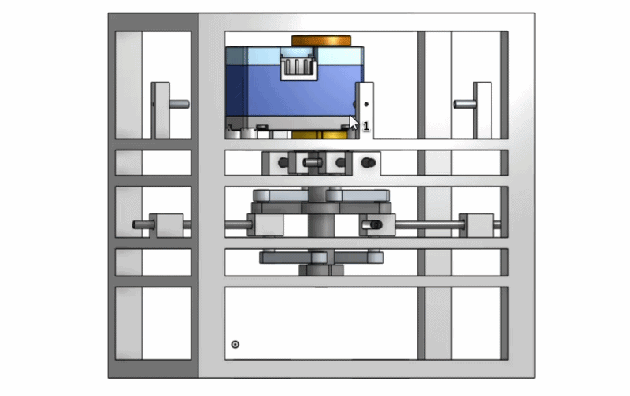
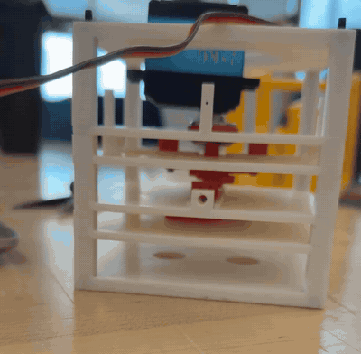
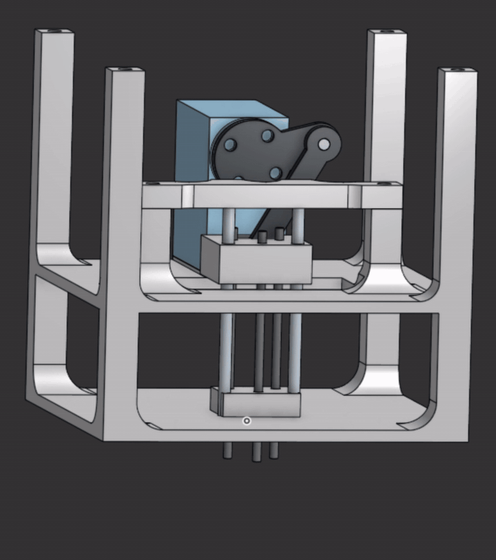
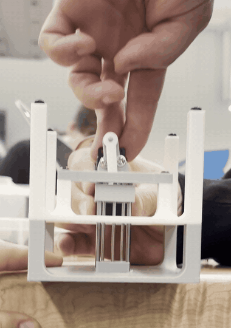

# Design history: pitot deployment mechanism

How the mechanism changed and why, oldest first. I've printed both mechanism designs in PLA+ and run
them on the servo. No flight hardware exists yet, nothing has been load tested, and nothing has flown.

[Back to the project page](../../README.md)

## 1. Original goal: wind speed from four directions

The first idea was four pitot probes sticking out of the four sides of the payload to measure wind
speed from each direction.

Why it changed: after a review with a Kent State faculty member, the team decided that reading wouldn't
be accurate enough. We switched the probes to descent speed, which a probe pointing down can read
directly as the payload falls. Wind speed and direction are now roughly estimated from GPS instead.

## 2. First mechanism: four probes out of the sides

One servo turns a hex hub 90 degrees. The hub drives four arms on two levels, each arm pushes a sled on
guide rods, and each sled carries one stainless probe out through the payload wall. All four probes
come out together from one servo.

The catch: to measure descent speed with this layout, every probe tip has to turn 90 degrees to face
down. That caused three problems.

- Bending the tube. The probes are small-bore stainless tube, and when I tried bending one by hand it
  kinked. A kink or a change in the bore can throw off the pressure reading.
- Stowing a bent tip. The printed frame sits inside a metal chassis, so every down-turned tip would need
  its own pocket in the frame wall and a matching slot in the chassis.
- Keeping the tip pointed down. A round tube in a round guide can spin, so each probe would need
  something to hold its direction.

## 3. Current revision: straight probes out of the bottom (November 2026)

Since we're measuring along the descent direction now, I turned the whole mechanism to point that way.
The probes stay straight and come out through the bottom plate already facing into the airflow.

One servo turns a crank, a link drives a carriage down two steel guide rods, and the carriage pushes the
probes through a guide in the base plate. The model has three probes right now.

That gets rid of the tube bend, the wall pockets and chassis slots, and the need to keep each tip
pointed the right way. While modeling it I also added a bridge across the tops of the guide rods.
Without it each rod is only held at the bottom, and the carriage sits at the unsupported end when it's
stowed.

## Next steps

- Design the servo mount (right now the servo is a placeholder block).
- Settle the probe count and add a lock to hold the probes in during boost.
- Finish the FEA and pick materials for the crank, link and guide rods.
- Check that nothing hanging under the payload on the tether messes with the airflow at the probes.
- Take it through team review.

CAD exports for this revision are in [`payload/mechanism/cad/bottom-deploy`](../mechanism/cad/bottom-deploy).
